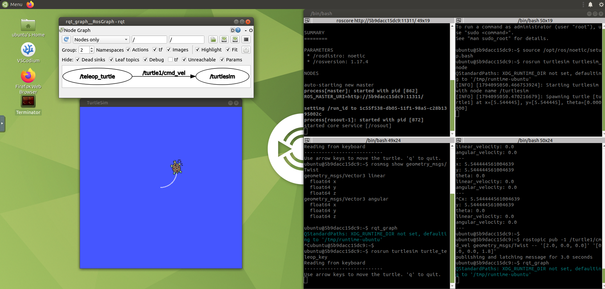

# ros-aprendizaje

Aprendiendo **ROS 1** y **ROS 2** desde cero con Docker: guias, ejemplos de codigo y bitacora, con la meta de programar robots humanoides.



*Primer sistema ROS 1 funcionando: tortuga simulada, cuatro terminales y el grafo de nodos (`rqt_graph`).*

## Como esta organizado

| Carpeta | Contenido |
|---|---|
| [`docker/`](docker/README.md) | Entorno completo en Docker (ROS 1 Noetic + ROS 2 Jazzy) y como ejecutarlo |
| [`ros1/`](ros1/README.md) | Curso de ROS 1: una carpeta con README por leccion, y el workspace `catkin_ws` |
| [`ros2/`](ros2/) | Workspace `ros2_ws` para ROS 2 (en preparacion) |
| [`docs/`](docs/bitacora.md) | Bitacora de aprendizaje y capturas generales |

## Lecciones

### ROS 1

| # | Leccion | Estado |
|---|---|---|
| 1 | [Tu primer sistema ROS: nodos, topics y turtlesim](ros1/lecciones/leccion-01-turtlesim/README.md) | Hecha |
| 2 | Workspace catkin y compilar `curso_ros1` | Pendiente |
| 3 | Publicador y suscriptor en Python | Pendiente |
| 4 | Controlar la tortuga con codigo | Pendiente |
| 5 | Servicios | Pendiente |
| 6 | Launch files y parametros | Pendiente |
| 7 | Herramientas utiles | Pendiente |

Indice completo, conceptos y errores comunes: [`ros1/README.md`](ros1/README.md).

### ROS 2

Pendiente: se hara despues de ROS 1.

## Inicio rapido

Requisitos: Windows con [Docker Desktop](https://www.docker.com/products/docker-desktop/) (backend WSL 2) y unos 10 GB libres.

```powershell
git clone https://github.com/camilotenorio1234/ros-aprendizaje.git
cd ros-aprendizaje\docker
docker compose up -d ros1
```

Abre <http://127.0.0.1:6081> (usuario `ubuntu`, contrasena `ubuntu`) y empieza por la [Leccion 1](ros1/lecciones/leccion-01-turtlesim/README.md).
Para ROS 2: `docker compose up -d ros2` y <http://127.0.0.1:6080>.

Detalles, capturas y solucion de problemas: [`docker/README.md`](docker/README.md).

## Ruta de aprendizaje

- [x] Entorno Docker con ROS 1 y ROS 2
- [x] ROS 1, Leccion 1: nodos, topics y turtlesim
- [ ] ROS 1, Lecciones 2 a 7
- [ ] ROS 2: nodos, topics, servicios y `colcon`
- [ ] URDF, `tf`, RViz y Gazebo
- [ ] `ros_control` y MoveIt 2
- [ ] Proyecto: robot humanoide

## Versiones

| | Distribucion | Ubuntu | Imagen Docker |
|---|---|---|---|
| ROS 1 | Noetic (fin de soporte en 2025; solo para aprender) | 20.04 | `tiryoh/ros-desktop-vnc:noetic` |
| ROS 2 | Jazzy (LTS hasta 2029) | 24.04 | `tiryoh/ros2-desktop-vnc:jazzy` |

Las imagenes son de [Tiryoh](https://github.com/Tiryoh/docker-ros2-desktop-vnc) y dan un escritorio Ubuntu accesible desde el navegador.
