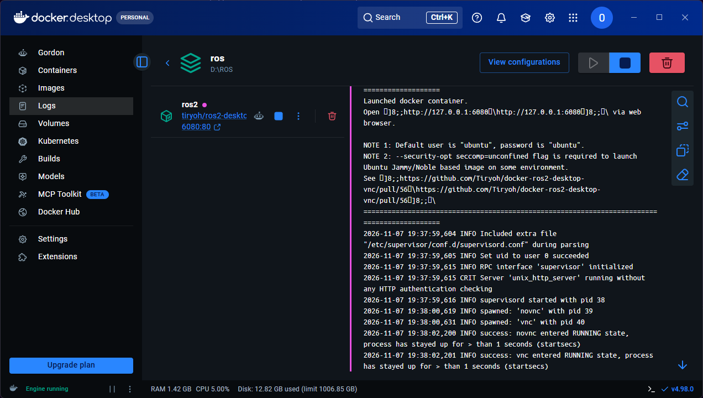
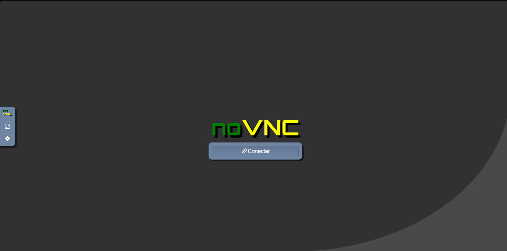
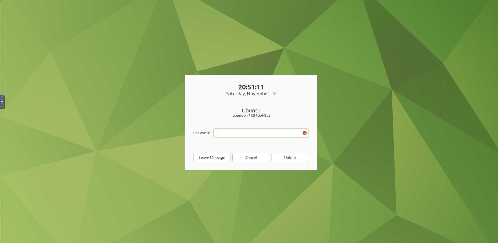

# Ejecutar todo con Docker

Dos contenedores, cada uno con un escritorio Ubuntu completo accesible desde el navegador:

| Servicio | Contenedor | Ubuntu | Dirección | Carpeta de trabajo (Windows → contenedor) |
|---|---|---|---|---|
| `ros2` | `ros2-jazzy` | 24.04 | <http://127.0.0.1:6080> | `ros2/ros2_ws` → `~/ros2_ws` |
| `ros1` | `ros1-noetic` | 20.04 | <http://127.0.0.1:6081> | `ros1/catkin_ws` → `~/catkin_ws` |

Usuario `ubuntu`, contraseña `ubuntu`.

## Requisitos

- Windows 10/11 con **Docker Desktop** instalado, abierto y con el backend **WSL 2** activo (abajo a la izquierda debe decir *Engine running*).
- Unos 10 GB libres: cada imagen pesa 3-4 GB.
- Recomendado 16 GB de RAM. Con menos, levanta un solo servicio a la vez.

## 1. Levantar un entorno

Desde PowerShell, en esta carpeta (`docker/`):

```powershell
docker compose up -d ros2     # solo ROS 2
docker compose up -d ros1     # solo ROS 1
docker compose up -d          # ambos
docker compose ps             # ver el estado
```

También puedes hacer doble clic en `iniciar-ros2.bat` o `iniciar-ros1.bat`: arrancan el servicio y abren el navegador.

La primera vez descarga las imágenes (varios minutos). Para ver el progreso o los errores:

```powershell
docker compose logs -f ros2
```

Cuando el servicio está listo, el log muestra que `novnc` y `vnc` están en estado `RUNNING`:



## 2. Entrar al escritorio

Abre la dirección del servicio en el navegador y pulsa **Conectar**:



Si ves una pantalla de bloqueo pidiendo contraseña, escribe `ubuntu` y pulsa **Unlock**:



En el escritorio, haz doble clic en **Terminator** para abrir una terminal con paneles
(`Ctrl+Shift+O` divide hacia abajo, `Ctrl+Shift+E` hacia la derecha).

## 3. Comprobar que ROS funciona

**ROS 2** (en una terminal del escritorio de `ros2`):

```bash
source /opt/ros/jazzy/setup.bash
ros2 run turtlesim turtlesim_node
```

**ROS 1** (en una terminal del escritorio de `ros1`):

```bash
source /opt/ros/noetic/setup.bash
roscore                                # panel 1, déjalo abierto
rosrun turtlesim turtlesim_node        # panel 2
```

En ambos casos debe aparecer una ventana azul con una tortuga. Sigue con la [guía de ROS 1](../ros1/GUIA_ROS1.md).

## 4. Terminal desde PowerShell (sin GUI)

Para comandos que no abren ventanas:

```powershell
docker exec -it ros2-jazzy bash
docker exec -it ros1-noetic bash
```

Las ventanas gráficas (turtlesim, rqt, RViz) conviene lanzarlas desde terminales **dentro del escritorio web**, no desde aquí.

## 5. Apagar y limpiar

```powershell
docker compose stop           # apagar sin borrar
docker compose start          # volver a encender
docker compose down           # borrar contenedores (tu código NO se pierde)
```

Tu código vive en `ros1/` y `ros2/` del repositorio, montado dentro del contenedor, así que sobrevive a `down`.

## Cómo está armado el `docker-compose.yml`

| Opción | Para qué sirve |
|---|---|
| `image` | Imagen con Ubuntu + ROS + escritorio ya instalados |
| `ports: "6080:80"` | El puerto 80 del contenedor (escritorio web) se ve en el 6080 de Windows |
| `volumes` | Monta `ros1/catkin_ws` y `ros2/ros2_ws` dentro del contenedor |
| `shm_size: 1gb` | Evita que el navegador y las GUIs se cierren por falta de memoria compartida |
| `security_opt: seccomp=unconfined` | La imagen lo requiere para arrancar en algunos entornos |
| `restart: unless-stopped` | El contenedor vuelve a arrancar con Docker Desktop |
| `ROS_DOMAIN_ID=0` | Identificador de red de ROS 2 (los nodos con el mismo ID se ven entre sí) |

## Solución de problemas

| Síntoma | Causa y solución |
|---|---|
| `lookup production.cloudfront.docker.com: no such host` al descargar | Falla de DNS. Reintenta; si persiste, desactiva el VPN o añade `"dns": ["8.8.8.8", "1.1.1.1"]` en Docker Desktop → Settings → Docker Engine y pulsa *Apply & restart* |
| `No such container: ros1-noetic` | El contenedor aún no existe. Ejecuta primero `docker compose up -d ros1` |
| `container name ... is already in use` | Hay contenedores de una versión anterior del proyecto. Ejecuta `docker rm -f ros2-jazzy ros1-noetic` y vuelve a levantar |
| El navegador no conecta | Espera unos segundos tras `up -d` y recarga. Revisa `docker compose logs ros2` |
| Pantalla de bloqueo pidiendo contraseña | Usuario `ubuntu`, contraseña `ubuntu` |
| `rosrun`/`ros2` no se reconoce | Falta `source /opt/ros/<distro>/setup.bash` en esa terminal |
| Compilar tarda mucho | Las carpetas de Windows montadas son más lentas que el disco de Linux. Más adelante se puede mover el workspace a un volumen de Docker |

## Nota sobre ROS 1

Noetic llegó al fin de su soporte en 2025. Sirve para aprender los conceptos y leer código antiguo, pero para proyectos nuevos se usa ROS 2.
