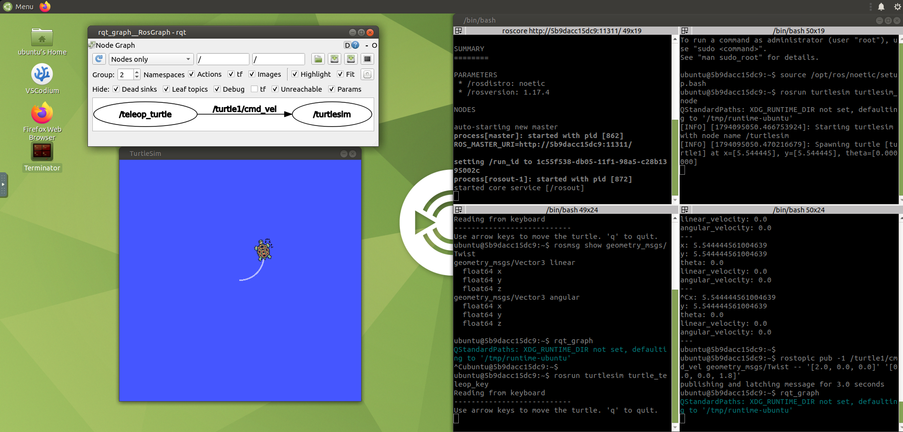

# Guia ROS 1 (Noetic) desde cero

Entorno: contenedor `ros1-noetic` (Ubuntu 20.04, ROS Noetic, Python 3).
Escritorio: http://127.0.0.1:6081  (usuario `ubuntu`, clave `ubuntu`)
Tu codigo: carpeta `ros1/catkin_ws` del repositorio  =  `~/catkin_ws` dentro del contenedor.

Como trabajar: abre el escritorio web y usa terminales dentro de el
(o `docker exec -it ros1-noetic bash` desde PowerShell). En CADA terminal nueva:

    source /opt/ros/noetic/setup.bash

---------------------------------------------------------------------------
## Leccion 0 - Las 5 ideas de ROS

| Concepto  | Que es                                              | Analogia                     |
|-----------|-----------------------------------------------------|------------------------------|
| Nodo      | Programa pequeno que hace UNA tarea                 | Un empleado especializado    |
| Master    | `roscore`: directorio donde los nodos se encuentran | La recepcion / agenda        |
| Topic     | Canal con nombre; unos publican, otros escuchan     | Una radio: emisor y oyentes  |
| Mensaje   | El tipo de dato que viaja por un topic              | El formato del mensaje       |
| Servicio  | Pregunta puntual con respuesta (peticion/respuesta) | Una llamada telefonica       |

Un robot = muchos nodos conversando: camara, motores, planificador...

---------------------------------------------------------------------------
## Leccion 1 - Tu primer sistema ROS (turtlesim)

Terminal 1 (el master; dejalo abierto):

    roscore

Terminal 2 (la simulacion):

    rosrun turtlesim turtlesim_node

Terminal 3 (control con teclado, ten esta ventana seleccionada):

    rosrun turtlesim turtle_teleop_key

Ahora inspecciona el sistema en una Terminal 4:

    rosnode list                      # nodos vivos
    rostopic list                     # topics existentes
    rostopic info /turtle1/cmd_vel    # quien publica / quien escucha
    rostopic echo /turtle1/pose       # datos en vivo (Ctrl+C para salir)
    rosmsg show geometry_msgs/Twist   # estructura del mensaje
    rqt_graph                         # dibujo de nodos y topics

Publicar a mano (la tortuga avanza y gira una vez):

    rostopic pub -1 /turtle1/cmd_vel geometry_msgs/Twist -- '[2.0, 0.0, 0.0]' '[0.0, 0.0, 1.8]'

Los dos grupos son la velocidad lineal [x, y, z] y la angular [x, y, z].

Ejercicio: usa `rqt_graph` y explica con tus palabras que nodo publica y cual
escucha en `/turtle1/cmd_vel`.

Resultado esperado:

Respuesta: `/teleop_turtle` PUBLICA y `/turtlesim` ESCUCHA (la flecha va del que publica al que escucha).

---------------------------------------------------------------------------
## Leccion 2 - Workspace y compilar el paquete de ejemplos

Un workspace catkin es la carpeta donde viven y se compilan tus paquetes.
Ya tienes `~/catkin_ws/src/curso_ros1` con ejemplos.

IMPORTANTE (una sola vez): la carpeta esta montada desde Windows y ahi no se
pueden crear enlaces simbolicos, asi que creamos el archivo a mano:

    cp --remove-destination /opt/ros/noetic/share/catkin/cmake/toplevel.cmake ~/catkin_ws/src/CMakeLists.txt

Compilar:

    cd ~/catkin_ws
    catkin_make
    source devel/setup.bash           # hacerlo tras CADA compilacion
    rospack find curso_ros1           # debe mostrar la ruta del paquete

Si ves "Permission denied" al ejecutar un script:
`chmod +x ~/catkin_ws/src/curso_ros1/scripts/*.py`

Estructura de un paquete:

    curso_ros1/
    ├── package.xml        <- nombre, dependencias
    ├── CMakeLists.txt     <- como se compila / instala
    ├── scripts/           <- nodos en Python
    └── launch/            <- arranque de varios nodos

---------------------------------------------------------------------------
## Leccion 3 - Publicador y suscriptor (topics)

Lee `scripts/talker.py` y `scripts/listener.py` (tienen comentarios).
Flujo: `init_node` -> crear Publisher/Subscriber -> bucle o `spin`.

    roscore                                   # Terminal 1
    rosrun curso_ros1 talker.py               # Terminal 2
    rosrun curso_ros1 listener.py             # Terminal 3
    rqt_graph                                 # ver la conexion

Ejercicios:
1. Cambia la frecuencia a 5 Hz y recompila (no hace falta recompilar scripts
   Python ya instalados por catkin_make con enlaces; si no ves el cambio,
   vuelve a hacer `catkin_make`).
2. Cambia el topic a `/saludo` en AMBOS nodos. Si solo cambias uno, no se
   hablan: asi se rompen las conexiones en ROS.
3. Ejecuta dos listeners a la vez y mira que ambos reciben todo.

---------------------------------------------------------------------------
## Leccion 4 - Controlar la tortuga con codigo

    roscore
    rosrun turtlesim turtlesim_node
    rosrun curso_ros1 mover_tortuga.py

Publicas `geometry_msgs/Twist` en `/turtle1/cmd_vel`: `linear.x` avanza,
`angular.z` gira. Ese mismo mensaje mueve robots reales.

Ejercicios:
1. Haz que dibuje un circulo mas grande y otro mas pequeno.
2. Modifica el nodo para que avance 3 segundos y luego se detenga.
3. Suscribete a `/turtle1/pose` y muestra la posicion x, y en pantalla.

---------------------------------------------------------------------------
## Leccion 5 - Servicios

    roscore
    rosrun curso_ros1 servidor_suma.py
    rosrun curso_ros1 cliente_suma.py 3 4         # imprime 3 + 4 = 7

Herramientas:

    rosservice list
    rosservice type /sumar
    rosservice call /sumar "a: 10
    b: 5"

Topic = flujo continuo sin respuesta. Servicio = pregunta y respuesta.

Ejercicio: crea un servicio que reciba un numero y devuelva su doble
(pista: reutiliza `rospy_tutorials/AddTwoInts` poniendo b = a, o crea tu .srv).

---------------------------------------------------------------------------
## Leccion 6 - Launch files y parametros

Un launch arranca varios nodos y `roscore` de una vez:

    roslaunch curso_ros1 pubsub.launch
    roslaunch curso_ros1 tortuga.launch

Parametros (configuracion compartida):

    rosparam list
    rosparam get /turtlesim/background_r
    rosparam set /turtlesim/background_r 255
    rosservice call /clear

Ejercicio: crea tu propio `.launch` que arranque talker, listener y turtlesim.

---------------------------------------------------------------------------
## Leccion 7 - Herramientas utiles

    rqt                      # panel con plugins
    rqt_plot /turtle1/pose/x # graficar un valor
    rosbag record -a         # grabar todos los topics
    rosbag play archivo.bag  # reproducirlos
    rosnode info /nombre     # detalle de un nodo
    roswtf                   # diagnostico del sistema

---------------------------------------------------------------------------
## Errores comunes

| Mensaje / sintoma                           | Causa y solucion                                   |
|---------------------------------------------|----------------------------------------------------|
| `command not found: rosrun`                 | Falta `source /opt/ros/noetic/setup.bash`          |
| `Package 'curso_ros1' not found`            | Falta `source ~/catkin_ws/devel/setup.bash`        |
| `Unable to contact my own server / master`  | `roscore` no esta corriendo                        |
| `Permission denied` al ejecutar un .py      | `chmod +x` al script                               |
| `catkin_make` falla con enlace simbolico    | Haz el `cp --remove-destination` de la Leccion 2   |
| Nodo corre pero no recibe nada              | Topic con nombre distinto: revisa `rostopic list`  |

---------------------------------------------------------------------------
## Siguientes pasos (hacia robots humanoides)

1. Escribir los mismos nodos en C++ (rospy -> roscpp).
2. `tf`: sistemas de coordenadas y como se relacionan las partes del robot.
3. URDF: describir las articulaciones y eslabones de un robot.
4. RViz y Gazebo: visualizar y simular un robot.
5. `ros_control` (control de articulaciones). Luego pasa a ROS 2: lo
   aprendido aqui (nodos, topics, servicios) se mantiene; cambia la
   herramienta de compilacion (colcon), el lanzamiento y la API.

Referencia oficial: tutoriales en wiki.ros.org (seccion ROS/Tutorials).
