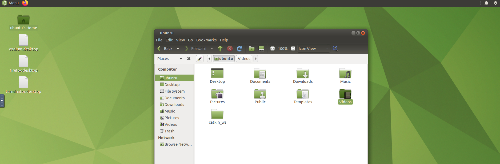
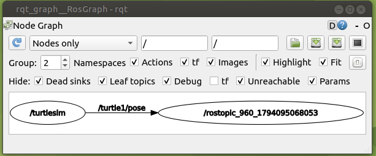
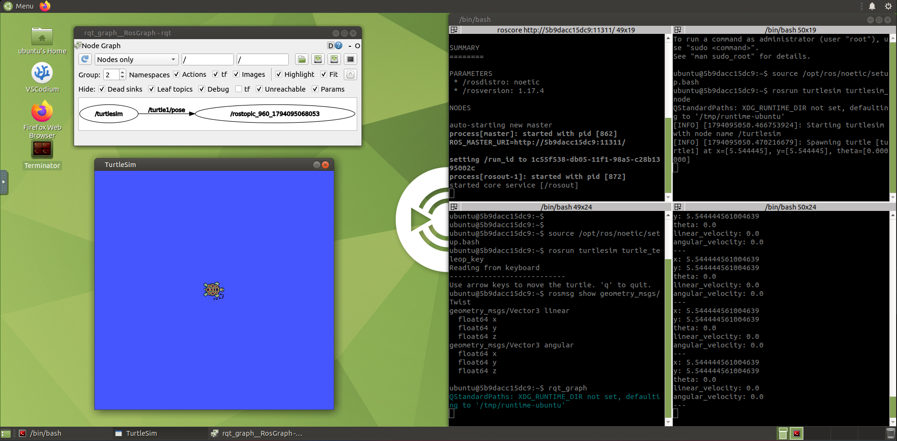
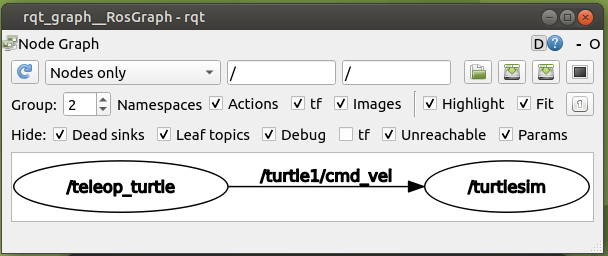
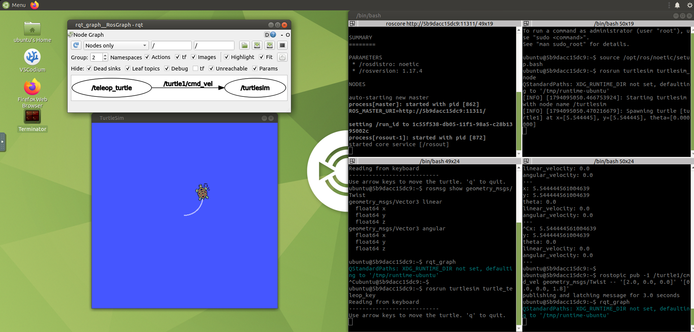

# Leccion 1: tu primer sistema ROS (nodos, topics y turtlesim)

[← Indice de ROS 1](../../README.md) · Siguiente: Leccion 2 (pendiente)

## Objetivo

Arrancar un sistema ROS 1 real, mover una tortuga simulada y **ver como se hablan los nodos** entre si.

Al terminar sabras:

- Que es un **nodo**, el **master** (`roscore`) y un **topic**.
- Arrancar nodos con `rosrun` e inspeccionarlos con `rosnode` y `rostopic`.
- Leer la estructura de un mensaje con `rosmsg`.
- Dibujar el sistema con `rqt_graph`.
- Publicar un mensaje a mano con `rostopic pub`.

## Antes de empezar

1. Docker Desktop abierto.
2. Entorno ROS 1 levantado desde PowerShell:
   ```powershell
   cd D:\ros-aprendizaje\docker
   docker compose up -d ros1
   ```
3. Abre <http://127.0.0.1:6081>, pulsa **Conectar** y, si pide contrasena, escribe `ubuntu`.

Mas detalles del entorno en [`docker/README.md`](../../../docker/README.md).

## Paso 0: abrir Terminator con 4 paneles

Este es el escritorio de ROS 1. A la izquierda esta el icono **Terminator** (`terminator.desktop`) y en la carpeta personal ya aparece `catkin_ws`, que es tu carpeta de Windows montada dentro del contenedor.



Haz doble clic en **Terminator**. Es una terminal que se divide en paneles:

| Atajo | Accion |
|---|---|
| `Ctrl+Shift+O` | Divide el panel hacia abajo |
| `Ctrl+Shift+E` | Divide el panel hacia la derecha |
| `Ctrl+Shift+V` | Pega texto |

Divide hasta tener **4 paneles**. En esta leccion los llamamos asi:

```
┌─────────────┬─────────────┐
│  Panel 1    │  Panel 2    │
│  roscore    │  turtlesim  │
├─────────────┼─────────────┤
│  Panel 3    │  Panel 4    │
│  teclado    │  inspeccion │
└─────────────┴─────────────┘
```

En **cada panel** escribe primero esto (carga los comandos de ROS en esa terminal):

```bash
source /opt/ros/noetic/setup.bash
```

> **Regla de oro:** un panel = un proceso. Si un comando se queda "ocupando" el panel (por ejemplo `roscore`), no escribas nada mas ahi: usa otro panel.

## Paso 1: arrancar el master (Panel 1)

```bash
roscore
```

`roscore` es el **master**: el directorio donde los nodos se registran y se encuentran. Sin el, los nodos de ROS 1 no pueden comunicarse. Debe quedar abierto todo el rato.

Salida esperada (lo importante es la ultima linea):

```
... logging to /home/ubuntu/.ros/log/...
started roslaunch server http://5b9dacc15dc9:xxxxx/
ros_comm version 1.17.4

SUMMARY
========

PARAMETERS
 * /rosdistro: noetic
 * /rosversion: 1.17.4

NODES

auto-starting new master
process[master]: started with pid [862]
ROS_MASTER_URI=http://5b9dacc15dc9:11311/
...
process[rosout-1]: started with pid [872]
started core service [/rosout]
```

## Paso 2: arrancar la simulacion (Panel 2)

```bash
rosrun turtlesim turtlesim_node
```

`rosrun <paquete> <nodo>` ejecuta un nodo. Aqui el paquete es `turtlesim` y el nodo es `turtlesim_node`: un simulador 2D con una tortuga.

Aparece una ventana azul con una tortuga y, en el panel, algo como:

```
[INFO] Starting turtlesim with node name /turtlesim
[INFO] Spawning turtle [turtle1] at x=[5.544445], y=[5.544445], theta=[0.000000]
```

> La linea `QStandardPaths: XDG_RUNTIME_DIR not set, defaulting to '/tmp/runtime-ubuntu'` es un aviso **inofensivo** del escritorio dentro de Docker. Ignorala.

## Paso 3: controlar la tortuga con el teclado (Panel 3)

```bash
rosrun turtlesim turtle_teleop_key
```

Haz clic en este panel y usa las **flechas** del teclado: la tortuga se mueve. Para salir pulsa `q`.

> El panel debe estar seleccionado: las teclas se leen desde ahi.

Dejalo corriendo. Ahora tienes **3 nodos** vivos: `/rosout` (de `roscore`), `/turtlesim` y `/teleop_turtle`.

## Paso 4: inspeccionar el sistema (Panel 4)

En el Panel 4 vamos a *preguntarle* a ROS que esta pasando.

### Nodos vivos

```bash
rosnode list
```

```
/rosout
/teleop_turtle
/turtlesim
```

### Topics existentes

```bash
rostopic list
```

```
/rosout
/rosout_agg
/turtle1/cmd_vel
/turtle1/color_sensor
/turtle1/pose
```

Un **topic** es un canal con nombre. Los que nos importan:

| Topic | Para que sirve |
|---|---|
| `/turtle1/cmd_vel` | Ordenes de velocidad para la tortuga |
| `/turtle1/pose` | Posicion actual de la tortuga |

### Quien publica y quien escucha

```bash
rostopic info /turtle1/cmd_vel
```

Salida similar a:

```
Type: geometry_msgs/Twist

Publishers:
 * /teleop_turtle (http://5b9dacc15dc9:xxxxx/)

Subscribers:
 * /turtlesim (http://5b9dacc15dc9:xxxxx/)
```

Lee esto como una frase: *el nodo `/teleop_turtle` **publica** mensajes de tipo `geometry_msgs/Twist` en `/turtle1/cmd_vel`, y el nodo `/turtlesim` los **escucha**.*

### Ver datos en vivo

```bash
rostopic echo /turtle1/pose
```

Imprime sin parar la posicion de la tortuga:

```
x: 5.544444561004639
y: 5.544444561004639
theta: 0.0
linear_velocity: 0.0
angular_velocity: 0.0
---
```

Mueve la tortuga con el Panel 3 y veras cambiar los numeros. **Detenlo con `Ctrl+C`** cuando termines: mientras corra, ocupa el Panel 4.

### Estructura de un mensaje

```bash
rosmsg show geometry_msgs/Twist
```

```
geometry_msgs/Vector3 linear
  float64 x
  float64 y
  float64 z
geometry_msgs/Vector3 angular
  float64 x
  float64 y
  float64 z
```

Un `Twist` es una velocidad con dos partes, cada una con tres numeros (x, y, z):

- `linear`: cuanto **avanza** (para la tortuga, `linear.x`).
- `angular`: cuanto **gira** (para la tortuga, `angular.z`).

Es el mismo mensaje que mueve robots reales.

## Paso 5: dibujar el sistema con `rqt_graph`

```bash
rqt_graph
```

Se abre una ventana con un dibujo de los nodos (ovalos) y los topics (flechas con nombre). La flecha va **de quien publica a quien escucha**.

### Una trampa: los comandos `rostopic` tambien son nodos

Si el `rostopic echo /turtle1/pose` del paso anterior sigue corriendo, el grafo se ve asi:



Ese nodo raro, `/rostopic_960_...`, **es tu propio comando `echo`**: para escuchar un topic, `rostopic` se registra como un nodo anonimo. Aqui `/turtlesim` publica `/turtle1/pose` y el `echo` lo escucha. Es correcto, pero no es el grafo de `cmd_vel` que queriamos ver.

Esta es la vista general en ese momento, con los cuatro paneles ocupados:



### El grafo correcto

1. Detén el `echo` con `Ctrl+C`.
2. Asegurate de que el teclado (`turtle_teleop_key`) esta corriendo en el Panel 3.
3. Cierra `rqt_graph` con `Ctrl+C` y vuelve a abrirlo (o pulsa el boton azul de refrescar).

Resultado:



> En el desplegable, **Nodes only** muestra los topics como el nombre sobre cada flecha. **Nodes/Topics (all)** los dibuja ademas como cajas propias.

## Paso 6: publicar un mensaje a mano (Panel 4)

Ya sabes que `/turtlesim` escucha `/turtle1/cmd_vel`. Vamos a hablarle nosotros, sin el teclado:

```bash
rostopic pub -1 /turtle1/cmd_vel geometry_msgs/Twist -- '[2.0, 0.0, 0.0]' '[0.0, 0.0, 1.8]'
```

Desglose:

| Parte | Significado |
|---|---|
| `rostopic pub` | Publicar un mensaje |
| `-1` | Publicar **una sola vez** |
| `/turtle1/cmd_vel` | Topic donde publicar |
| `geometry_msgs/Twist` | Tipo de mensaje |
| `--` | Marca el fin de las opciones (asi los numeros negativos no se confunden con opciones) |
| `'[2.0, 0.0, 0.0]'` | `linear`: x, y, z, avanza 2.0 |
| `'[0.0, 0.0, 1.8]'` | `angular`: x, y, z, gira 1.8 sobre z |

Salida:

```
publishing and latching message for 3.0 seconds
```

La tortuga avanza y gira una vez, dejando un trazo curvo. Es **el mismo mensaje** que enviaba el teclado, escrito a mano.

## Resultado final

Todo el sistema funcionando: `roscore`, la simulacion, el teclado, el panel de inspeccion y el grafo.



## Ejercicio y respuesta

**Pregunta:** usando `rqt_graph`, ¿que nodo publica y cual escucha en `/turtle1/cmd_vel`?

**Respuesta:** `/teleop_turtle` **publica** y `/turtlesim` **escucha**. La flecha va del que publica al que escucha.

**Para practicar por tu cuenta:**

1. Publica con otros valores, por ejemplo `'[1.0, 0.0, 0.0]'` y `'[0.0, 0.0, -1.0]'`. ¿Hacia donde gira?
2. Cambia `-1` por `-r 1` para publicar una vez por segundo (`Ctrl+C` para parar). ¿Que hace la tortuga?
3. Ejecuta `rosnode info /turtlesim` y localiza sus publicaciones y suscripciones.

## Errores que nos pasaron

| Que paso | Por que | Solucion |
|---|---|---|
| `rosmsg` y `rqt_graph` en el panel del teclado | El teclado ya habia terminado y `rqt_graph` quedo ocupando el panel | Un panel = un proceso. Usa el Panel 4 para inspeccionar |
| El grafo mostraba `/rostopic_960...` y no `/teleop_turtle` | El `echo` seguia corriendo y el teclado no | `Ctrl+C` al `echo` y volver a lanzar el teclado |
| `Unable to contact my own server` | `roscore` no estaba corriendo | Arrancarlo en el Panel 1 |
| `command not found` | Falta el `source` en esa terminal | `source /opt/ros/noetic/setup.bash` |

## Resumen de comandos

| Comando | Que hace |
|---|---|
| `roscore` | Arranca el master |
| `rosrun <paquete> <nodo>` | Ejecuta un nodo |
| `rosnode list` | Lista los nodos vivos |
| `rostopic list` | Lista los topics |
| `rostopic info <topic>` | Tipo, quien publica y quien escucha |
| `rostopic echo <topic>` | Muestra los mensajes en vivo |
| `rostopic pub <topic> <tipo> ...` | Publica un mensaje |
| `rosmsg show <tipo>` | Muestra la estructura de un mensaje |
| `rqt_graph` | Dibuja nodos y topics |

## Lo que aprendiste

- ROS 1 necesita un **master** (`roscore`) para que los nodos se encuentren.
- Un **nodo** hace una tarea; los nodos se comunican por **topics**.
- Quien **publica** envia mensajes; quien **escucha** (se suscribe) los recibe.
- Puedes inspeccionar y hasta "hablar" con un sistema en marcha sin tocar su codigo.

**Siguiente:** Leccion 2, compilar un workspace catkin y el paquete de ejemplos `curso_ros1`.
