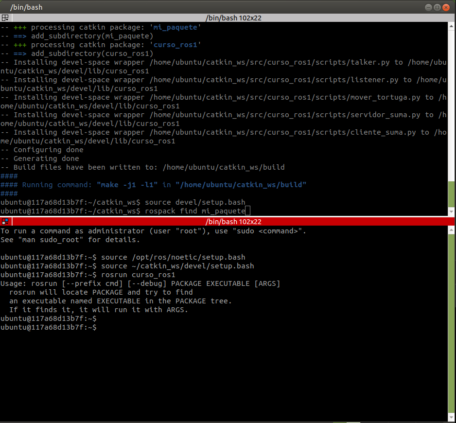
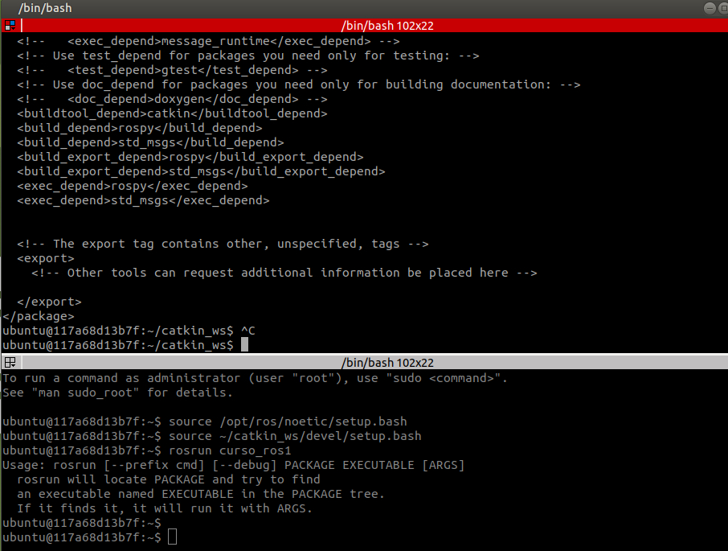

# Leccion 2: workspace de catkin y compilar un paquete

[← Leccion 1](../leccion-01-turtlesim/README.md) · [Indice de ROS 1](../../README.md) · Siguiente: Leccion 3 (pendiente)

## Objetivo

Entender **donde vive y como se compila el codigo de ROS 1**: el workspace de catkin y los paquetes.

Al terminar sabras:

- Que es un **workspace** y que es un **paquete**.
- Compilar con `catkin_make` y activar el workspace con `source devel/setup.bash`.
- Comprobar que ROS encuentra tu paquete con `rospack find`.
- Que contienen `package.xml` y `CMakeLists.txt`.
- Crear un paquete nuevo con `catkin_create_pkg`.

Esta leccion **no necesita** `roscore` ni turtlesim: solo se compila.

## Conceptos

| Concepto | Que es |
|---|---|
| **Workspace** | Carpeta donde viven y se compilan tus paquetes (`~/catkin_ws`) |
| **Paquete** | Unidad minima de codigo en ROS: una carpeta con `package.xml` y `CMakeLists.txt` |
| `src/` | Donde pones el codigo fuente (tus paquetes) |
| `build/` | Archivos temporales de la compilacion (se genera solo) |
| `devel/` | Resultado de compilar; contiene `setup.bash` (se genera solo) |

```
catkin_ws/
├── src/                      <- TU codigo
│   ├── CMakeLists.txt        <- raiz del workspace (paso 2)
│   └── curso_ros1/           <- un paquete
├── build/                    <- generado por catkin_make
└── devel/                    <- generado por catkin_make
```

## Antes de empezar

Entorno ROS 1 levantado (ver [`docker/README.md`](../../../docker/README.md)):

```powershell
cd D:\ros-aprendizaje\docker
docker compose up -d ros1
```

Abre <http://127.0.0.1:6081>, y en el escritorio abre **Terminator** con **2 paneles**
(`Ctrl+Shift+E` divide hacia la derecha o abajo, segun el atajo). Los llamamos:

```
┌──────────────────┬──────────────────┐
│     Panel A      │     Panel B      │
│  (trabajo)       │  (comprobacion)  │
└──────────────────┴──────────────────┘
```

> En esta leccion todo se hace en el Panel A, salvo el paso 5, que va en el Panel B.

## Paso 1: mirar el workspace (Panel A)

```bash
source /opt/ros/noetic/setup.bash
cd ~/catkin_ws
ls
ls src
ls src/curso_ros1
```

Salida real:

```
src
curso_ros1
CMakeLists.txt  launch  package.xml  scripts
```

`~/catkin_ws` dentro del contenedor es la carpeta `ros1/catkin_ws` de tu Windows.
Todavia no existen `build/` ni `devel/`: se crean al compilar.

## Paso 2: crear el archivo raiz del workspace (Panel A)

```bash
cp --remove-destination /opt/ros/noetic/share/catkin/cmake/toplevel.cmake ~/catkin_ws/src/CMakeLists.txt
```

No imprime nada si sale bien.

Todo workspace de catkin necesita un `CMakeLists.txt` en `src/` que le diga a CMake como encontrar los paquetes. Normalmente `catkin_make` lo crea como un **enlace simbolico** a la plantilla de ROS. Windows no permite enlaces simbolicos en carpetas montadas, asi que lo **copiamos como archivo normal**. Es una plantilla: no hay que editarla.

Donde queda:

| Lugar | Ruta |
|---|---|
| Dentro del contenedor | `~/catkin_ws/src/CMakeLists.txt` |
| En Windows | `D:\ros-aprendizaje\ros1\catkin_ws\src\CMakeLists.txt` |

> No lo confundas con el `CMakeLists.txt` de `curso_ros1`: ese es solo del paquete.

## Paso 3: compilar (Panel A)

```bash
cd ~/catkin_ws
catkin_make
```

Salida real, resumida:

```
Base path: /home/ubuntu/catkin_ws
Source space: /home/ubuntu/catkin_ws/src
Build space: /home/ubuntu/catkin_ws/build
Devel space: /home/ubuntu/catkin_ws/devel
Install space: /home/ubuntu/catkin_ws/install
####
#### Running command: "cmake /home/ubuntu/catkin_ws/src -DCATKIN_DEVEL_PREFIX=... " in ".../build"
####
-- Using CMAKE_PREFIX_PATH: /opt/ros/noetic
-- This workspace overlays: /opt/ros/noetic
-- Using PYTHON_EXECUTABLE: /usr/bin/python3
-- catkin 0.8.12
-- ~~  traversing 1 packages in topological order:
-- ~~  - curso_ros1
-- +++ processing catkin package: 'curso_ros1'
-- ==> add_subdirectory(curso_ros1)
-- Installing devel-space wrapper .../scripts/talker.py to /home/ubuntu/catkin_ws/devel/lib/curso_ros1
-- Installing devel-space wrapper .../scripts/listener.py to ...
-- Installing devel-space wrapper .../scripts/mover_tortuga.py to ...
-- Installing devel-space wrapper .../scripts/servidor_suma.py to ...
-- Installing devel-space wrapper .../scripts/cliente_suma.py to ...
-- Configuring done
-- Generating done
-- Build files have been written to: /home/ubuntu/catkin_ws/build
####
#### Running command: "make -j1 -l1" in "/home/ubuntu/catkin_ws/build"
####
```

Como leerlo:

| Linea | Que significa |
|---|---|
| `Base path`, `Source space`, `Build space`, `Devel space` | Las carpetas que usa catkin |
| `This workspace overlays: /opt/ros/noetic` | Tu workspace se **apila encima** de la instalacion de ROS |
| `traversing 1 packages` | Encontro 1 paquete en `src/`: `curso_ros1` |
| `Installing devel-space wrapper ... talker.py` | Creo un lanzador de cada script en `devel/lib/curso_ros1/`; asi lo encuentra `rosrun` |
| `Configuring done` / `Generating done` | CMake termino sin errores |
| `make -j1 -l1` | Fase de compilacion. Como los scripts son Python, no hay nada que compilar |

Sin errores = bien. Aqui se ve el final de la salida (arriba) y, abajo, el Panel B del paso 5:



Ahora en Windows aparecen `build/` y `devel/` dentro de `ros1/catkin_ws`. Estan en el `.gitignore`, asi que no se suben a GitHub.

## Paso 4: activar el workspace (Panel A)

```bash
source devel/setup.bash
rospack find curso_ros1
```

Salida real:

```
/home/ubuntu/catkin_ws/src/curso_ros1
```

`source devel/setup.bash` le dice a esa terminal donde estan **tus** paquetes. Sin eso, `rospack` solo conoce los de ROS.

Una prueba de que funciono: en la segunda compilacion (ejercicio), la salida cambia a
`Using CMAKE_PREFIX_PATH: /home/ubuntu/catkin_ws/devel;/opt/ros/noetic`.
Ahora `devel` aparece **delante** de ROS: tu workspace ya esta activo.

Reglas:

- Hay que hacer `source devel/setup.bash` en **cada terminal nueva**.
- Y despues de **cada** `catkin_make` si agregas paquetes nuevos.

> Opcional: para no repetirlo, `echo "source ~/catkin_ws/devel/setup.bash" >> ~/.bashrc`.
> Funciona hasta que borres el contenedor.

## Paso 5: comprobar que ROS ve tus scripts (Panel B)

En el Panel B (una terminal nueva que no sabe nada del workspace):

```bash
source /opt/ros/noetic/setup.bash
source ~/catkin_ws/devel/setup.bash
rosrun curso_ros1 
```

Despues de `rosrun curso_ros1` deja **un espacio**, pulsa **Tab dos veces** y **no pulses Enter**. Debe listar los 5 scripts:
`cliente_suma.py  listener.py  mover_tortuga.py  servidor_suma.py  talker.py`

Para ver lo mismo con `ls` (Panel A):

```bash
ls ~/catkin_ws/devel/lib/curso_ros1
```

```
cliente_suma.py  listener.py  mover_tortuga.py	servidor_suma.py  talker.py
```

> Si escribes solo `rosrun curso_ros1` y pulsas Enter, sale este mensaje (es normal, no es un error):
>
> ```
> Usage: rosrun [--prefix cmd] [--debug] PACKAGE EXECUTABLE [ARGS]
> ```
>
> `rosrun` necesita **dos** cosas: el paquete **y** el ejecutable.

Para que Tab liste los scripts, deben ser ejecutables. Aqui lo son (`x` en los permisos):

```bash
ls -l ~/catkin_ws/src/curso_ros1/scripts
```

```
-rwxrwxrwx 1 ubuntu ubuntu 478 ... cliente_suma.py
-rwxrwxrwx 1 ubuntu ubuntu 441 ... listener.py
-rwxrwxrwx 1 ubuntu ubuntu 542 ... mover_tortuga.py
-rwxrwxrwx 1 ubuntu ubuntu 470 ... servidor_suma.py
-rwxrwxrwx 1 ubuntu ubuntu 640 ... talker.py
```

(Si alguno no tuviera `x`: `chmod +x ~/catkin_ws/src/curso_ros1/scripts/*.py`.)

## Paso 6: anatomia de un paquete

```
curso_ros1/
├── package.xml        <- nombre, version, autor y dependencias
├── CMakeLists.txt     <- como se instala / compila
├── scripts/           <- nodos en Python
└── launch/            <- arranque de varios nodos
```

### `package.xml`: la "ficha" del paquete

El de `curso_ros1`:

```xml
<package format="2">
  <name>curso_ros1</name>
  <version>0.1.0</version>
  <description>Ejemplos para aprender ROS 1 (Noetic) desde cero</description>
  <maintainer email="tu@correo.com">Alumno</maintainer>
  <license>MIT</license>

  <buildtool_depend>catkin</buildtool_depend>
  <depend>rospy</depend>
  <depend>std_msgs</depend>
  <depend>geometry_msgs</depend>
  <depend>rospy_tutorials</depend>
  <exec_depend>turtlesim</exec_depend>
</package>
```

| Etiqueta | Para que sirve |
|---|---|
| `<name>` | Nombre del paquete (el que usas en `rosrun`) |
| `<version>`, `<description>`, `<maintainer>`, `<license>` | Datos del paquete |
| `<buildtool_depend>catkin</buildtool_depend>` | Herramienta para compilar |
| `<depend>` | Paquete que se necesita para compilar **y** para ejecutar |
| `<exec_depend>` | Paquete que solo se necesita al ejecutar |

Aqui `rospy` es la libreria de ROS para Python, `std_msgs` trae mensajes basicos (`String`), `geometry_msgs` trae `Twist`, y `turtlesim` solo hace falta para ejecutar la tortuga.

### `CMakeLists.txt`: como se instala

```cmake
cmake_minimum_required(VERSION 3.0.2)
project(curso_ros1)

find_package(catkin REQUIRED COMPONENTS rospy std_msgs geometry_msgs rospy_tutorials)

catkin_package()

catkin_install_python(PROGRAMS
  scripts/talker.py
  scripts/listener.py
  scripts/mover_tortuga.py
  scripts/servidor_suma.py
  scripts/cliente_suma.py
  DESTINATION ${CATKIN_PACKAGE_BIN_DESTINATION}
)
```

| Linea | Que hace |
|---|---|
| `project(curso_ros1)` | Nombre del proyecto (debe coincidir con `<name>`) |
| `find_package(catkin REQUIRED COMPONENTS ...)` | Busca catkin y las dependencias |
| `catkin_package()` | Declara el paquete a catkin |
| `catkin_install_python(PROGRAMS ...)` | Lista los scripts. **Es lo que genero las lineas `Installing devel-space wrapper`** del paso 3 |

> **Regla:** si agregas un script nuevo en `scripts/`, tambien hay que ponerlo en esta lista y volver a ejecutar `catkin_make`. Si no, `rosrun` no lo encuentra.

## Paso 7: crear tu propio paquete (ejercicio, Panel A)

```bash
cd ~/catkin_ws/src
catkin_create_pkg mi_paquete rospy std_msgs
cd ~/catkin_ws
catkin_make
source devel/setup.bash
rospack find mi_paquete
```

Salida real de `catkin_create_pkg`:

```
Created file mi_paquete/package.xml
Created file mi_paquete/CMakeLists.txt
Created folder mi_paquete/src
Successfully created files in /home/ubuntu/catkin_ws/src/mi_paquete. Please adjust the values in package.xml.
```

El comando es `catkin_create_pkg <nombre> <dependencias...>`. Crea la estructura minima: `CMakeLists.txt`, `package.xml` y la carpeta `src`.

En la segunda compilacion, catkin ahora ve **2 paquetes**:

```
-- ~~  traversing 2 packages in topological order:
-- ~~  - mi_paquete
-- ~~  - curso_ros1
```

Y `rospack find mi_paquete` devuelve:

```
/home/ubuntu/catkin_ws/src/mi_paquete
```

El `package.xml` que genero. Al final se ven las dependencias, que `catkin_create_pkg` escribe una por una:



```xml
<buildtool_depend>catkin</buildtool_depend>
<build_depend>rospy</build_depend>
<build_depend>std_msgs</build_depend>
<build_export_depend>rospy</build_export_depend>
<build_export_depend>std_msgs</build_export_depend>
<exec_depend>rospy</exec_depend>
<exec_depend>std_msgs</exec_depend>
```

Esas tres lineas por paquete (`build_depend` + `build_export_depend` + `exec_depend`) son lo mismo que la unica linea `<depend>` que usa `curso_ros1`: es un atajo.

Dos valores que conviene ajustar en un paquete tuyo:

- `<license>TODO</license>` → una licencia real (por ejemplo `MIT`).
- `<maintainer email="ubuntu@todo.todo">` → tu nombre y correo.

## Errores que nos pasaron

| Que paso | Por que | Solucion |
|---|---|---|
| `ls: cannot open directory '.'` y `The specified base path "/home/ubuntu/catkin_ws" does not exist` | El contenedor era el viejo y apuntaba a la carpeta anterior (`D:\ROS\...`), que ya no existia | Recrear el contenedor desde la carpeta nueva: `docker rm -f ros1-noetic ros2-jazzy`, luego `cd docker` y `docker compose up -d ros1` |
| `cp ... No such file or directory` | La misma causa: `~/catkin_ws/src` estaba roto | Idem |
| `rosrun curso_ros1` + Enter muestra `Usage: rosrun ...` | Falta el nombre del ejecutable | Escribir `rosrun curso_ros1 ` y pulsar Tab dos veces, o dar el nombre completo |
| El `cp` no imprimio nada | No es un error: en Linux, sin mensaje significa que salio bien | Comprobar con `ls -l ~/catkin_ws/src` |

## Resumen de comandos

| Comando | Que hace |
|---|---|
| `catkin_make` | Compila todo el workspace (se ejecuta en `~/catkin_ws`) |
| `source devel/setup.bash` | Activa el workspace en esa terminal |
| `rospack find <paquete>` | Muestra donde esta un paquete |
| `catkin_create_pkg <nombre> <deps>` | Crea un paquete nuevo |
| `rosrun <paquete> <script>` | Ejecuta un nodo (Tab completa los nombres) |

## Que subir a GitHub

| Archivo o carpeta | ¿Se sube? |
|---|---|
| `ros1/catkin_ws/src/CMakeLists.txt` | Si: asi quien clone el repo tiene el workspace listo |
| `ros1/catkin_ws/src/mi_paquete/` | Si: es la evidencia del ejercicio |
| `ros1/catkin_ws/build/` y `devel/` | No: estan en el `.gitignore` |

## Lo que aprendiste

- El codigo de ROS vive en **paquetes**, dentro de un **workspace** (`src/`).
- `catkin_make` compila; `build/` y `devel/` se generan solos.
- `source devel/setup.bash` activa **tu** workspace en cada terminal.
- `package.xml` declara dependencias; `CMakeLists.txt` declara que se instala.
- Un script nuevo hay que registrarlo en `CMakeLists.txt` y recompilar.

**Siguiente:** Leccion 3, escribir un publicador y un suscriptor en Python con los scripts `talker.py` y `listener.py` de este paquete.
